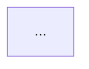

# UML Diagrams (Mermaid)

One file per diagram. Every diagram carries traceability frontmatter.

## Frontmatter (mandatory)

The `model` gate (`gates/model.sh`) refuses any `.mmd` file that does not start with a `%% sources:` line.

## C4 Model

| Level | File | Question |
|---|---|---|
| Context | `c4-context.mmd` | Who + which external systems? |
| Container | `c4-container.mmd` | Which deployable units? |
| Component | `c4-component.mmd` | Which modules inside each container? |
| Code | `c4-code-<component>.mmd` | Which classes / functions? (only for non-trivial components) |

## Sequence and State

- `sequence-<flow>.mmd` per key flow (referenced in a story's acceptance criteria)
- `state-<entity>.mmd` per lifecycle (referenced in the PRD or an ADR)

## Naming

- Lowercase, kebab-case.
- Prefix by diagram type: `c4-`, `sequence-`, `state-`.
- No spaces, no underscores.

## Traceability Rule

Every diagram's first line is a Mermaid comment: `%% sources: <list>`. The list references PRD sections, ADR numbers, or story IDs. The `model` phase gate enforces this; `gates/model.sh` exits non-zero if any required diagram lacks it.