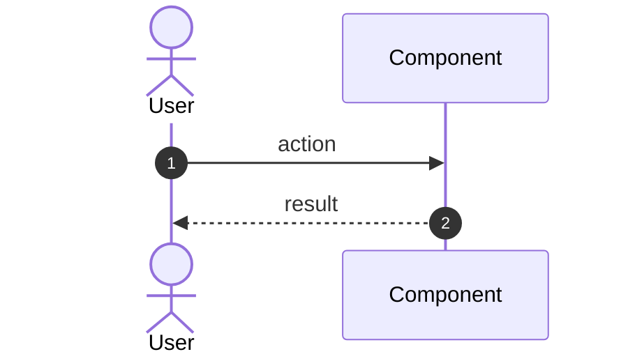

<!-- approved_by stays empty in drafts. The agent fills in 'user' after the
     user approves the rendered design in chat. 'autopilot' counts only in
     auto mode 'full' — in the default mode 'build' a design always needs the
     user. The design gate waits (exit 3) while it is empty. -->

# ITER-NN <Title>

Covers stories: US-001, US-002   <!-- must match docs/plan.md for this iteration -->

## Goal

One sentence: the user-visible value this iteration delivers.

## Approach

Which pattern(s), which components change, why this way and not the obvious
alternative. Reference the ADRs that constrain the choice.



<!-- Add a class diagram, state diagram, or flowchart if the change warrants it.
     Every ```mermaid block lands on the rendered review page. -->

## Affected Components

| Component | Change | C4 ref |
|---|---|---|
|  |  | `uml/c4-component.mmd` |

## Test Strategy

- Unit: ...
- Acceptance: scenarios from `tests/features/US-NNN-*.feature`
- What could break elsewhere, and how we would notice.

## Verification

<!-- Filled during the `verify` phase. Report on EVERY story listed above.
     The gate rejects unchecked boxes in this section. -->

- [ ] US-001 — all scenarios pass
- [ ] US-002 — all scenarios pass

## Notes

<!-- Yours, like '## Verification': everything above them is the approved
     design. Record the small, reversible choices you made yourself and what
     the next story's agent needs to know (conventions, files touched). A
     question you may NOT answer alone is not a note — open a decision:
     docs/decisions/DEC-NNN-*.md (templates/decision.template.md). -->

Open questions, follow-ups, deliberate deferrals.
